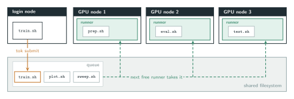
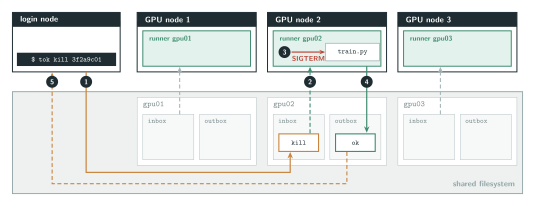

## ❓ What is this?

A masterless, filesystem-based job runner.

Tokimeki lets you submit and manage jobs across nodes that share a common filesystem but have no direct network connectivity. Almost communication happens through the shared filesystem, with no master node (except `tokimeki shell`).



A **job** is one piece of work that a runner executes. As with other job schedulers, a job in Tokimeki is mainly defined as a shell script that gets queued and executed. Other than that, Tokimeki also support *jobs as Python functions*. See the corresponding [Python package](https://github.com/hungngocphat01/tokimeki-py) for more information.

## ❓ Why Tokimeki?

If you work with PBS, SLURM, or similar job schedulers on a shared cluster, you've run into these situations:

1. You submitted a job, but the config is wrong. The job is already running. If you delete it and resubmit, you go back to the end of the queue, possibly waiting another day for a node. You want to replace the process running inside your allocation without giving up the slot.

2. Your task finishes early. You requested 24 hours of running time, but the computation completed in 10 hours, and the job exits. The remaining 14 hours that should have been allocated to you are wasted. You want to feed another task into the same allocation.

Tokimeki solves both. You submit a PBS/SLURM job that starts a Tokimeki Runner, then interact with that runner from any node that shares the same filesystem with the runners:

```bash
# In the GPU allocation: start one runner process
#!/bin/bash
tokimeki runner --id node01 --manner-period 30m

# -------------------------------------------------

# From any other node: submit work at any time
# This works *before* any runner is ready
tokimeki submit do_compute.sh

# Wrong config? replace process immediately without re-entering scheduler queue
tokimeki kill <old_job_id>
tokimeki submit -w node01 -c "python do_compute.py --alpha 0.0003"
#                ^~~~ submits directly to node01

# Finished early? enqueue the next experiment in the same allocation
tokimeki submit eval-script.sh
```

The runner is polite and has good manners. It ends its lifecycle after being jobless for 1 hour (default), releasing the node to the underlying job scheduler. It does not work outside the limit committed to the underlying (e.g. PBS) scheduler.

## Etymology

Tokimeki was originally designed to run on top of the job system in the Kagayaki cluster.

In _a certain anime series_'s timeline, Tokimeki is the thing that comes after Kagayaki, which gives way to the name. The system's runner daemons are, of course, called _Tokimeki Runners_.

## Acknowledgement

This project was developed autonomously by Claude Code and OpenAI Codex based on my requirements and guidance.

## 🔧 Setup

You almost do not need to set anything up. Tokimeki packages everything in one Go binary. Instead, we make several assumptions:
1. Your worker (GPU) nodes have access to a shared filesystem (here we assume it's the home folder)
2. Your worker nodes execute jobs under the same Linux user

Since all physical GPU nodes can access a shared filesystem, simply copy Tokimeki there. Then, write one SLURM/PBS job:

```bash
#!/bin/bash
#PBS -q A100-VM
#PBS -oe
#PBS -lselect=1:ngpus=1

# Optional: set another Tokimeki job directory
export TOKIMEKI_HOME=/mnt/myreservedddir/.tokimeki

/home/mycorporateuser/.local/bin/tokimeki --manner-period 1h --name gpu01 --compute-threads 3
```

Then submit this job: `qsub tokimeki-1.sh`. If you need more nodes, simply clone the script and set another `--name`.

From now you interact with job submissions through `tokimeki` instead of `qsub` or `sbatch`.

## 💻 Quick start

```bash
# Build (needs access to the private engine module, see docs/BUILD.md)
make
tokimeki version

# Every node must see the same state directory
export TOKIMEKI_HOME=/shared/tokimeki

# On a compute node: start a runner
tokimeki runner --id node01

# From anywhere: submit a job (works even before the runner starts)
tokimeki submit solve.sh

# Check status
tokimeki runners        # list all runners
tokimeki ps             # running + queued jobs (queued jobs are unassigned)
tokimeki ps -a          # include finished jobs
tokimeki tui            # interactive live jobs, logs, and resources
tokimeki logs <job_id>  # view output
tokimeki job <job_id>   # job details
tokimeki watch <job_id> # block until it finishes
```

## 🏗️ Architecture

Tokimeki is **masterless**. There is no central scheduling daemon.

Tokimeki works over a shared filesystem. Each runner daemon is independent, and the CLI interacts with runners through that shared filesystem. A runner executes up to `--compute-threads` compute jobs at a time (default 1) plus at most one coordinator job. Only `tokimeki shell` uses networking; everything else, including `exec`, stays on the filesystem protocol.

When a runner has a free slot, it checks the shared queue for work. It acquires the global filesystem lock, dequeues an eligible job (after accounting for priority, partitioning and other things) and records them as running on that runner, then releases the lock before starting them. Each runner does this independently; the lock prevents two runners from taking the same job.

A coordinator (see [Run a sweep](#run-a-sweep)) is just a job that happens to submit other jobs; it is not a master, and if it dies, the jobs it already submitted keep running.

This means:

- No single point of failure. Runners are independent.
- Adding a new runner is just starting a new process with a unique `--id`.
- The system tolerates multi-second filesystem propagation delays by design.

### Manner period

Runners are polite. If a runner has been **jobless** for the manner period (default: 1 hour), it exits gracefully to give place to other jobs on the underlying job system. This also applies on startup — if a runner starts and finds no jobs in its queue, it waits for the manner period and exits if still jobless.

The manner timer resets every time a job is running or queued. So if jobs keep arriving, the runner stays alive indefinitely.

### Everything goes through files

The login node and the runners never communicate through networking. Every exchange between them is one side writing a file under `$TOKIMEKI_HOME` and the other side reading it later, so every node must see the same directory.

Work that any runner may do goes into the shared queue, as in the first figure: `tokimeki submit` writes the job there, and whichever runner has a free executor takes it. A message meant for one particular runner, such as `tokimeki kill`, `tokimeki exec`, or the setup of `tokimeki shell`, goes into that runner's own *inbox directory* instead. Each runner checks its inbox every couple of seconds, acts on what it finds, and writes the reply into its outbox, which the client keeps reading until the reply shows up.



The rest works the same way. Runners write their heartbeat, job status, and logs into the shared directory, and `tokimeki ps`, `tokimeki runners`, and `tokimeki logs` read them from there. The only exception is the terminal session of `tokimeki shell`, which is set up through the inbox and then runs over TCP (see [Interactive shell](#interactive-shell)).

Every write goes to a temporary file first and is then renamed into place, so a reader never sees half a file. This relies on `rename()` being atomic, which holds on local filesystems and NFS v3+; Tokimeki may not work reliably on remote filesystems that break that guarantee.

Below is the directory structure of `$TOKIMEKI_HOME`:

```
~/.tokimeki/
├── tmp/                             # staging for atomic writes (shared by all nodes)
├── shared/
│   ├── queue.json                   # global FIFO queue of pending job IDs
│   ├── .global-lock                 # registry lock file for queue/meta updates
│   └── reservations/                # durable dequeue reservations
│       └── <job_id>.json
├── workers/
│   └── <worker_id>/
│       ├── info.json                # static: hostname, pid, start_time, version
│       ├── heartbeat                # unix timestamp (nanoseconds), updated every tick
│       ├── inbox/                   # client writes .req files here
│       ├── outbox/                  # runner writes .resp files here
│       ├── shell/                   # private (0700) rendezvous files for open shell sessions
│       ├── stats.json               # resource sample per running job, plus their sum
│       └── running/                 # one <job_id>.json per running job (job ID, kind, PID, start)
│
└── jobs/
    └── <job_id>/
        ├── meta.json                # job record, schema 2: execute, status, timestamps (docs/protocol.md)
        ├── script.sh                # copy of the submitted job script
        ├── stdout.log               # captured stdout
        ├── stderr.log               # captured stderr
        ├── result.json              # optional, written by the job ($TOKIMEKI_JOB_RESULT)
        └── error.json               # optional, written by the job ($TOKIMEKI_JOB_ERROR)
```

### When a runner disappears

Allocations expire and nodes go offline. Queued jobs are not tied to any runner, so they simply start elsewhere. Jobs that were already running on the lost runner stop with it; Tokimeki does not migrate a job mid-run. Those jobs show as **stopped** in `tokimeki ps` until a runner with the same `--id` starts again, which then marks them **crashed** and requeues the ones submitted with `--retries`.

Jobs on other runners keep going, even when the lost job was their coordinator. A `tokimeki group --wait` can therefore return while a member is still stopped, so a coordinator should check that every expected result exists before writing its summary. A retried coordinator should likewise read `tokimeki group --json` and submit only the trials that are missing, since Tokimeki does not deduplicate.

### Interactive shell

`tokimeki shell gpu01` opens a real terminal on a runner without SSH, similar to `srun --pty`: colors, vim, htop, Ctrl-C, and window resizing all work. You can also press `s` on a runner in `tokimeki tui`.

```text
tokimeki shell                         runner gpu01
 1. listen on a TCP port, write private
    session file ---- shared FS ------>
 2. "shell" request ----- inbox ------> 3. spawn `shell-daemon` child
                                        4. read session file
 5. accept  <------- TLS over TCP ------   connect back, present token
 6. keystrokes, output, resizes <-----> 7. shell on a PTY
```

- **Network requirement:** the runner's node must be able to open a TCP connection to the machine running `tokimeki shell`. Runners listen on no ports. Use `--listen` and `--advertise` if the port or address needs to be specific.
- **Isolation:** all networking and PTY code runs in the separate `shell-daemon` process, so a bug there cannot crash the runner. If the runner dies, even by `kill -9`, its open shells are closed.
- **Same user:** Tokimeki assumes the client and runners log in as the same user and can all read and write the state directory. Multi-user setups are not supported.
- **Security:** traffic is encrypted, and the secrets are kept in a file only your user can read, so other users on the cluster can't join a session.
- **Manner period:** an open shell keeps the runner from exiting for being jobless, so close shells you're done with.

Protocol details are in the engine repository (`README.md`, "Interactive Shell Protocol").

## Advanced: run a sweep as a job group

This is an advanced use-case that has been introduced in Tokimeki v0.5.0.

A *sweep*, such as several learning rates for each of a few backbones, is where Tokimeki pays off most. The usual pattern is one **coordinator** per sweep: a job, submitted with `tokimeki submit -C`, that submits one job per trial, waits for them, and writes a summary. This is also the main use-case of a *Tokimeki coordinator*: a script that reads the config from disk, expand and submit other compute jobs, then gather the results after everything has finished. Think of it like... a distributed *for* loop.

Every *runner* has one coordinator slot next to its `--compute-threads` executors, so a coordinator never takes an executor from its own trials, and trials go to whichever executor is free on any runner. A **group** (`-g NAME`) labels a coordinator and every job it submits, so each sweep can wait for and summarise only its own trials while all sweeps share the same runners.


The trials are usually Python functions, so the example use-case, training an AlexNet and a VGG sweep run side by side, is in the [Python package's README](https://github.com/hungngocphat01/tokimeki-py#running-a-hyperparameter-sweep). For coordinators written as shell scripts, and for the group commands, see [Coordinators and groups](docs/USAGE.md#coordinators-and-groups) in the usage guide.


## CLI Reference

How submitting, runners, slots, groups and results fit together, and which
files carry them: **[docs/HOW-IT-WORKS.md](docs/HOW-IT-WORKS.md)**.

For a complete usage guide with examples, flags, and recipes (dependencies, retries, priority, resource hints, interactive exec, JSON output, event log, shell completion), see **[docs/USAGE.md](docs/USAGE.md)**.

Commands at a glance:

- `tokimeki runner`: start a runner daemon on the current node (`--compute-threads N` runs N compute jobs plus one coordinator)
- `tokimeki runners`: list known runners and their liveness
- `tokimeki ps` / `ls`: inspect queued and running jobs
- `tokimeki top`: one-shot summary with RUNNERS / JOBS / RECENT panels (`--plain`)
- `tokimeki submit`: submit scripts, an inline command, or a JSON request (`--from-json`; `--after`, `--priority`, `--cpus`, `--mem-mb`, `--retries`, `--backoff`, `-g/--group`, `-C/--coordinator`, `--desc`, `--live`, `--wait`, `--quiet`, `--json`)
- `tokimeki group <name>`: a group's counts and jobs (`--json` for coordinator scripts, `--wait` to block until its jobs finish)
- `tokimeki result <job>`: print the result a job wrote
- `tokimeki watch <job>`: block until terminal state; exit code = job's exit code
- `tokimeki shell <node>`: open a full interactive terminal on a runner (uses TCP)
- `tokimeki exec` (`-i` for interactive): run a one-off command on a target runner
- `tokimeki kp <node>`: run `killall python` on a target runner
- `tokimeki kill`: signal a running job (a coordinator also stops its group)
- `tokimeki cancel`: cancel a queued job (a coordinator also stops its group)
- `tokimeki logs`: show stdout and stderr for a job (`--follow`, `--tail`, `--stdout`, `--stderr`)
- `tokimeki job`: show job metadata
- `tokimeki events`: stream the shared event log
- `tokimeki gc`: clean up stale state (`--older-than`, `--max-size`, `--dry-run`)
- `tokimeki completion`: generate shell completion (bash/zsh/fish)
- `tokimeki version`: print build metadata

The binary can also be aliased to `tok` for brevity (`ln -s "$(which tokimeki)" ~/.local/bin/tok`); `tok` and `tokimeki` are interchangeable.

If your coordinator is Python, the [tokimeki Python package](https://github.com/hungngocphat01/tokimeki-py) submits Python functions as jobs and reads back their return values, instead of passing results through files.

## Configuration

| Environment Variable | Description | Default |
|---|---|---|
| `TOKIMEKI_HOME` | Base directory for all state | `~/.tokimeki` |
